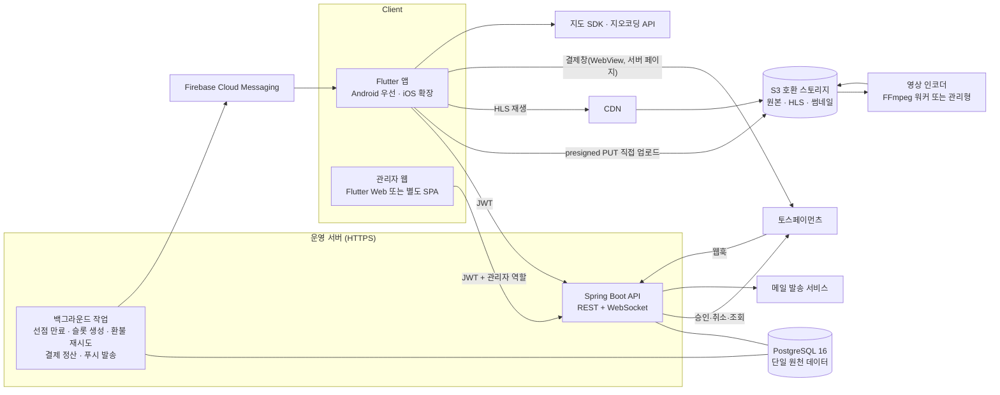
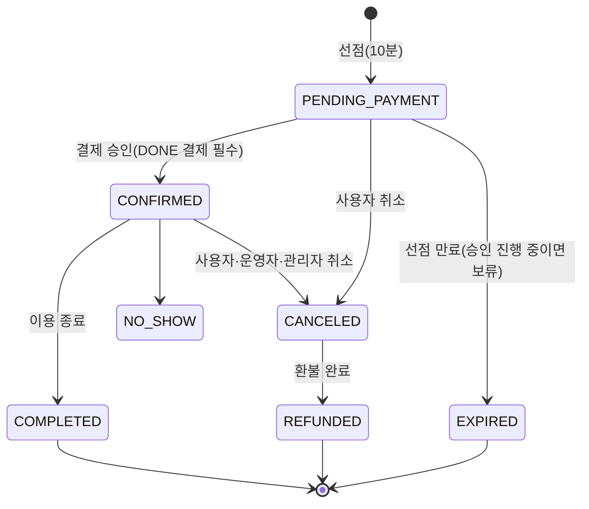
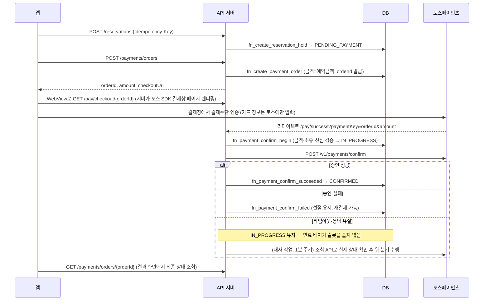

# 01. 아키텍처

> 상태: v1.0 (2026-10-10) — 구현 기준으로 갱신. 설계 단계와 달라진 점은 각 절에 "구현:"으로 표시했다.

## 1. 전체 구성



## 2. 데이터 소유권 원칙

| 데이터 | 소유자 | 비고 |
|---|---|---|
| 회원·인증·프로필·예약·결제·SNS·채팅·알림 목록 | **Spring Boot + PostgreSQL** | 단일 원천. Firebase에 사본을 두지 않는다 |
| 미디어 파일 | S3 호환 스토리지 | DB에는 오브젝트 키만 저장. URL은 응답 시 CDN 도메인으로 조합 |
| 결제수단(카드 등) | 토스페이먼츠 | 우리는 paymentKey, 영수증 URL, 승인 금액만 저장 |
| 푸시 전송 | Firebase(FCM) | **전송 채널로만 사용**. Firebase Auth·Firestore·Firebase Storage는 쓰지 않는다 |

Firebase Authentication을 쓰지 않는 이유: 인증을 Spring Security가 이미 담당하므로 두 시스템을 섞으면 탈퇴·정지·토큰 폐기 시점이 어긋난다. 소셜 로그인도 앱이 받은 공급자 토큰을 서버가 직접 검증한 뒤 우리 JWT를 발급한다.

## 3. 인증 흐름

- **비밀번호**: BCrypt(cost 12) 또는 Argon2id. 원문은 로그·DB 어디에도 남기지 않는다.
- **액세스 토큰**: JWT, 15분, `sub`, `role`, `tv`(users.token_version) 포함. 탈퇴·정지·비밀번호 변경 시 token_version을 올려 즉시 무효화한다.
- **리프레시 토큰**: 불투명 랜덤 256bit, 30일, DB에는 SHA-256 해시만 저장.
  - 갱신 시 회전(rotation): 기존 토큰 `rotated_at` 기록 후 같은 `family_id`로 새 토큰 발급.
  - 이미 회전된 토큰이 다시 오면 **탈취로 간주**하고 family 전체를 폐기한다 (`REUSE_DETECTED`).
- **앱 저장**: `flutter_secure_storage` (Android Keystore / iOS Keychain).
- **이메일 인증·비밀번호 재설정**: 일회용 토큰(해시 저장, 30분), 앱 딥링크로 처리. 미인증 계정은 예약·결제·게시물 작성 불가 (DB 함수에서도 강제).
- **소셜 로그인** (공식 SDK → 서버 검증)
  - 카카오: 앱에서 카카오 SDK 로그인 → 액세스 토큰 → 서버가 카카오 사용자정보 API로 검증
  - 구글: Google Sign-In ID 토큰 → 서버가 Google 공개키로 서명·aud 검증
  - 애플: iOS에서 타사 소셜 로그인을 제공하면 App Store 심사지침 4.8의 "동등한 로그인 옵션" 요건이 적용되므로 Apple 로그인으로 충족하는 것을 기본안으로 한다(출시 시점 지침 재확인). identityToken을 Apple 공개키로 검증
- **요청 제한**: 로그인·가입·인증메일 재발송·비밀번호 재설정은 IP+계정 기준 레이트 리밋 (구현: 서버 메모리 고정 창 방식, 서버 1대 기준 — 여러 대면 Redis로 교체, docs/05 §4). 로그인 5회 실패 시 15분 잠금(`users.locked_until`).

## 4. 예약·결제 일관성 설계 (핵심)

### 4.1 중복 예약 방지 — 3중 보장

1. **DB 배제 제약** `no_double_booking`: 같은 코트에서 `PENDING_PAYMENT`·`CONFIRMED` 예약끼리 시간 구간이 겹치면 INSERT 자체가 실패 (SQLSTATE 23P01 → API 409 `SLOT_TAKEN`).
2. **코트 단위 advisory lock**: 선점 생성 트랜잭션을 코트별로 직렬화. 배제 제약만 쓰면 동시 부분 겹침 요청에서 **교착상태가 발생함을 테스트로 확인**했고(C2) 이 잠금으로 제거했다.
3. **서버 계산**: 예약 금액은 클라이언트 값을 받지 않고 슬롯 요금 합으로 DB 함수가 계산.

클라이언트의 "예약 가능" 표시는 `fn_available_slots` 조회 결과일 뿐 보장이 아니다. 최종 판정은 항상 `fn_create_reservation_hold`.

### 4.2 예약 상태 머신 (DB 트리거로 강제)



### 4.3 결제 상태 머신 (토스 상태값과 동일 명칭)

`READY → IN_PROGRESS → DONE → PARTIAL_CANCELED → CANCELED`, 실패 시 `ABORTED`, 미사용 주문은 `EXPIRED`.
한 예약에서 `IN_PROGRESS/DONE/PARTIAL_CANCELED/CANCELED` 결제는 최대 1건 (유일 인덱스) → 이중 결제 차단.

### 4.4 결제 시퀀스와 실패 처리



| 상황 | 처리 |
|---|---|
| 클라이언트가 금액 변조 | 승인 API 호출 전 거부, 주문 ABORTED, 감사 로그 |
| 승인 버튼 더블탭·재시도 | 같은 주문은 1건만 IN_PROGRESS (C3 테스트) |
| 승인 응답 유실 | IN_PROGRESS 동안 슬롯 유지, 배치가 조회 API로 확정 |
| 웹훅·응답 중복 도착 | `ALREADY_DONE` 반환 (멱등) |
| 승인됐는데 확정 불가 (금액 불일치 등) | `NEEDS_COMPENSATION` → 즉시 전액 취소 요청 (보상) |
| 환불 API 실패 | 환불 REQUESTED 유지, 같은 Idempotency-Key로 지수 백오프 재시도, 3회 실패 시 운영 알림 |
| 동시 환불 요청 | 결제 행 잠금 + 합계 검증으로 승인 금액 초과 불가 (C5 테스트) |

웹훅은 본문을 그대로 신뢰하지 않는다. `secret` 값이 저장된 Payment.secret과 일치하는지 확인하고, 상태 반영 전 토스 조회 API로 재확인한다.

### 4.5 취소·환불 정책

구장별 `cancel_policy`(JSON)를 예약 시점에 `cancel_policy_snapshot`으로 복사해, 운영자가 나중에 정책을 바꿔도 기존 예약에는 예약 당시 정책을 적용한다. 기본값: 72시간 전 100%, 24시간 전 50%, 이후 0%. 운영자·관리자 사유 취소는 전액 환불.

## 5. 동영상 파이프라인

1. 앱이 `POST /videos/uploads`로 파일 크기·형식 신고 → 서버가 검증(500MB, mp4/mov) 후 **presigned PUT URL**(또는 멀티파트 업로드 URL 묶음) 발급. API 서버는 파일을 중계하지 않는다.
2. 앱이 스토리지로 직접 업로드하며 진행률 표시. 실패 시 멀티파트 파트 단위 재시도.
3. `POST /videos/{id}/complete` → 서버가 HEAD로 실제 크기 확인 → `UPLOADED` → 인코딩 큐 등록.
4. 인코더가 길이(1~90초) 측정, HLS(예: 360p/720p) + 썸네일 생성 → 콜백 → `READY` → 게시물 자동 공개.
5. 재생은 CDN의 HLS 매니페스트. 비공개 게시물 영상은 서명 URL/서명 쿠키로 제한.
6. 삭제·탈퇴 시 `DELETED` 전환 후 비동기로 원본·파생 파일 삭제.

인코더 선택지: AWS MediaConvert, NCP VOD Station 같은 관리형 서비스 또는 자체 FFmpeg 워커. 초기 비용은 FFmpeg 워커가 낮고, 트래픽이 늘면 관리형으로 전환.

## 6. 실시간 채팅과 알림

- WebSocket (구현: STOMP 없이 단순 JSON 프로토콜 `/ws/chat`, 연결 후 첫 메시지로 JWT 인증 — 토큰이 URL·접속 로그에 남지 않음. 프로토콜은 docs/02). 서버는 채팅방 참여자에게만 전달.
- 메시지 전송은 `client_message_id`(UUID)를 포함 → 재연결 후 재전송해도 1건만 저장(DB 유일 제약).
- 재연결: 지수 백오프 재접속 후 `GET /chats/{id}/messages?after={lastId}`로 누락분 동기화.
- 다중 서버로 확장 시 Redis Pub/Sub으로 다른 서버의 연결에 중계 (현재는 서버 1대 기준 메모리).
- 알림: `notifications` 행 생성 → 푸시 워커가 사용자 알림 설정·기기 토큰 확인 후 FCM 발송. 만료 토큰은 FCM 응답 기준으로 삭제.

## 7. 권한 모델

| 역할 | 범위 |
|---|---|
| USER | 본인 데이터, 공개 범위 규칙(`can_view_post`)을 통과한 타인 콘텐츠 |
| VENUE_OPERATOR | `venue_operators`에 연결된 구장의 정보·운영시간·슬롯·예약·운영자 취소 |
| MODERATOR | 신고 처리, 콘텐츠 숨김, 경고·기간 정지 |
| ADMIN | 전체 + 구장 검증, 강제 환불, 영구 정지. 모든 작업은 `admin_audit_logs`(수정·삭제 불가)에 기록 |

리소스 단위 인가는 서비스 계층에서 수행하고, 핵심 규칙(예약 소유, 운영자 범위, 차단, 채팅 참여자)은 DB 함수·트리거에서도 한 번 더 강제한다.

## 8. API 공통 규격

- 기본 경로 `/api/v1`, JSON, 시간은 ISO-8601(+09:00), 금액은 원 단위 정수.
- 오류 응답 (RFC 9457 Problem Details 기반):

```json
{ "type": "https://fmate.app/errors/slot-taken", "title": "이미 예약된 시간입니다",
  "status": 409, "code": "SLOT_TAKEN", "requestId": "01J..." }
```

- 상태를 바꾸는 POST에는 `Idempotency-Key` 헤더 필수 (예약 생성, 주문 생성, 승인, 취소, 게시물 생성). 같은 키+다른 본문이면 422.
- 목록은 커서 페이지네이션 `?cursor=&limit=` (최대 50). 구장 검색만 `?page=&size=`.
- 로그에는 요청 ID, 사용자 ID, 경로, 상태 코드만. 비밀번호·토큰·결제키·이메일은 마스킹 필터로 제거.

## 9. Flutter 앱 구조

```
app/lib/
  core/        # 테마, API 클라이언트(dio + 토큰 갱신), 모델, 저장소(repos), 세션, 채팅 소켓, 전역 서비스(AppScope)
  features/
    auth/      # 가입, 로그인, 이메일 인증, 비밀번호 재설정, 소셜 로그인
    home/      # 피드(최신·추천), 숏폼 진입
    booking/   # 날짜 선택, 지역 필터, 시간대 선택, 예약 확인, 결제, 예약 내역
    venues/    # 지도·목록 검색, 구장 상세
    shorts/    # 세로형 영상 피드, 업로드
    chat/      # 대화 목록, 채팅방
    profile/   # 마이페이지, 프로필(게시물·하이라이트 탭), 팔로워/팔로잉, 설정, 탈퇴
  shared/      # 공통 위젯: 로딩, 빈 상태, 네트워크 오류, 권한 거부, 결제 실패
```

- 구현: 외부 상태관리 패키지 없이 InheritedWidget(`AppScope`) + `ChangeNotifier`(세션) + `ValueNotifier`(기능 상태·알림 배지), 라우팅은 Navigator. 이메일 인증은 링크 대신 6자리 코드라 딥링크가 필요 없고, 결제 결과는 WebView가 서버 결과 페이지를 감지한다. 네트워크 dio.
- 하단 탭: 홈 · 예약 · 풋살장 · 채팅 · 마이페이지.
- 디자인 토큰: 흰 배경, 브랜드 그린 `#16A34A`(대비 4.5:1 이상 확인 후 확정), 카드 반경 16, 간격 4의 배수, 최소 터치 영역 48dp, 시스템 글자 크기 확대 대응.
- 모든 화면은 `로딩 / 데이터 / 빈 상태 / 오류` 4상태를 갖고, 실데이터가 없으면 빈 상태를 보여준다(샘플 데이터 위장 금지).
- 환경 분리: `--dart-define=ENV=dev|staging|prod`, 결제 TEST 모드에서는 화면 상단에 "테스트 결제" 배지를 항상 표시.
